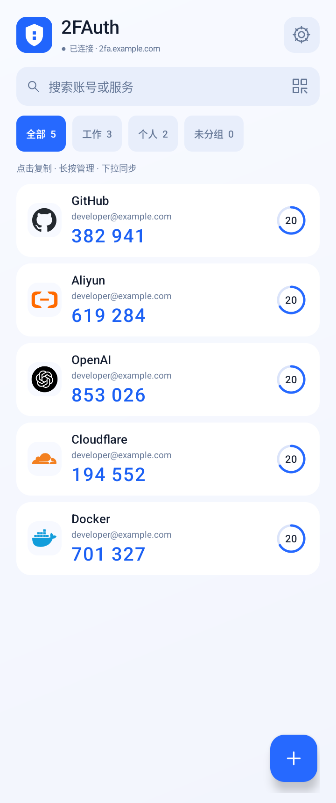
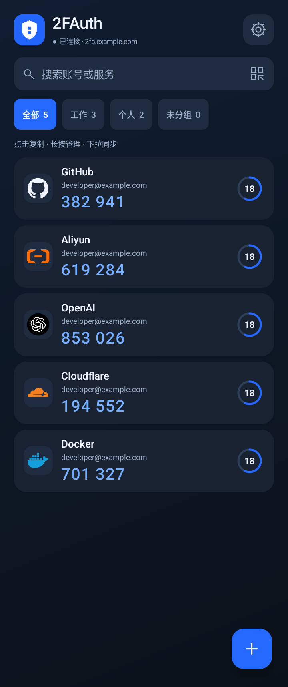
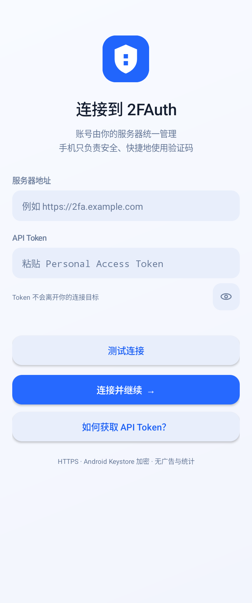
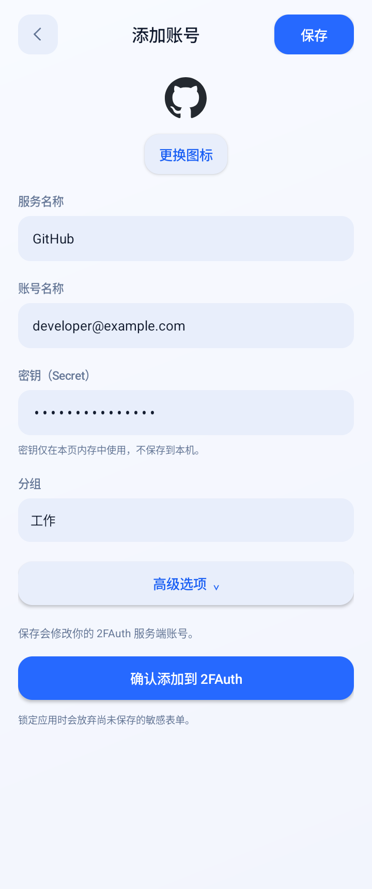
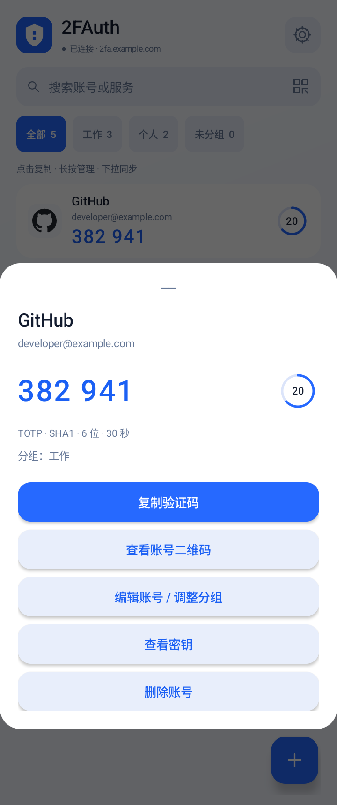
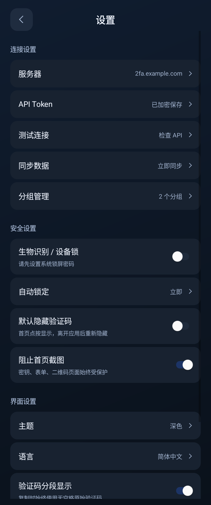

# 2FAuth Pocket

为自托管 [2FAuth](https://docs.2fauth.app/) 用户打造的轻量原生 Android 客户端。
账号由自己的服务器统一管理，手机端用于查看验证码、扫描添加账号和日常管理。

**自托管连接 · 一键复制 · 扫码添加 · 深浅色主题**

> 本项目是非官方客户端，目前处于测试阶段。需要已有的 2FAuth 服务，不是离线验证器，也不提供公共验证码托管服务。

## 页面预览

以下为 Android 模拟器中的实际界面。服务器域名、账号和验证码均为测试数据，仅用于演示，不包含真实 Token 或账号密钥。

<table>
  <tr>
    <th>验证码首页 · 浅色</th>
    <th>验证码首页 · 深色</th>
  </tr>
  <tr>
    <td></td>
    <td></td>
  </tr>
  <tr>
    <th>服务连接</th>
    <th>添加账号</th>
  </tr>
  <tr>
    <td></td>
    <td></td>
  </tr>
  <tr>
    <th>账号管理</th>
    <th>设置 · 深色</th>
  </tr>
  <tr>
    <td></td>
    <td></td>
  </tr>
</table>

## 功能

| 功能 | 说明 |
| --- | --- |
| 验证码 | TOTP 自动刷新、圆环倒计时、一键复制；HOTP 手动生成并确认 |
| 搜索与分组 | 按服务或账号搜索、分组筛选、下拉同步 |
| 添加账号 | 相机扫码、相册识别、手动输入；预览确认后保存 |
| 账号管理 | 编辑信息和高级参数、调整分组、查看二维码、删除账号 |
| 分组管理 | 创建、重命名、删除分组，删除分组不删除账号 |
| 服务图标 | 位图与静态 SVG 图标、自定义图片、内置品牌图标回退 |
| 安全设置 | 生物识别或设备凭据解锁、锁定延时、隐藏验证码、截图保护 |
| 界面 | 浅色、深色或跟随系统；验证码分段显示 |

## 使用要求

- Android 8.0 或更高版本。
- 可通过 HTTPS 访问的 2FAuth 实例，以及该实例的 Personal Access Token。
- 网络连接：验证码由服务器生成，客户端不在离线状态生成新验证码。
- 建议启用系统锁屏 PIN、密码或生物识别。编辑、删除、查看密钥和二维码等敏感操作需要设备身份验证。

客户端按 2FAuth API 1.4.0 定义实现。不同服务器版本的接口支持可能存在差异。

## 安装与连接

已发布版本可从 [GitHub Releases](https://github.com/liuheo/2fauth-pocket/releases) 下载 `.apk` 附件，无需解压。若尚无发行版本，可[从源码构建](docs/BUILDING.md)，或下载 Actions 中的 Debug 测试产物（ZIP 内包含 APK）。安装前请确认来源；测试构建不等同于正式发行版本。

1. 打开自己的 2FAuth 网页，在 **Settings → OAUTH** 或 **Personal Access Tokens** 中创建客户端专用 Token。
2. 启动应用，填写服务器网站根地址，例如 `https://2fa.example.com`。不要追加 `/api/v1`。
3. 填写 Token，点击“测试连接”，成功后点击“连接并继续”。
4. 在首页点击验证码复制，长按账号打开管理菜单，通过右下角按钮添加账号。

**应用不预填服务器地址。** 示例域名只是输入提示，不会自动连接。Token 不是账户密码，请勿分享。

## 隐私与安全

- 连接信息通过 Android Keystore 加密保存；不建立持久化账号数据库或离线密钥库。
- 普通账号同步不获取密钥，敏感操作在设备验证后按需获取。
- 相册二维码在手机本地识别，不上传整张图片；识别结果仅提交到用户配置的服务器进行预览。
- 无广告和统计 SDK。API 请求仅使用 HTTPS，不绕过证书错误或自动跟随重定向。
- 敏感页面限制截图；复制内容会尝试定时清理，但受 Android 后台限制影响，不能保证始终清除。

有关密钥、二维码、剪贴板和设备保护的详细说明，见[安全说明](docs/SECURITY.md)。

## 常见问题

**没有自己的 2FAuth 服务器可以使用吗？**

需要先部署 2FAuth，或连接自己信任且有访问权限的实例。应用不内置默认服务器。

**断网时还能获取验证码吗？**

不能生成新码。已显示的 TOTP 到期后会隐藏，恢复网络后可同步。应用不能替代离线验证器或恢复码。

**为什么无法编辑账号或查看二维码？**

这些操作需要设备身份验证。请先在系统设置中启用锁屏 PIN 或密码；有生物识别时也可使用生物识别验证。

**请求超时后可以直接再操作一次吗？**

新增、修改、删除和 HOTP 生成可能已经在服务器执行。请先同步或在网页核对，再决定是否重试。

**如何断开连接？**

在设置中清除本机连接。如需撤销访问权限，还必须在 2FAuth 网页中撤销对应 Token。

**哪些功能尚未支持？**

离线验证码、批量迁移、数据导入导出、桌面小组件和多语言。当前界面为简体中文。

## 开发与反馈

- [构建、测试与签名](docs/BUILDING.md)
- [安全说明](docs/SECURITY.md)

反馈问题时请提供应用版本、Android 版本、复现步骤和已脱敏的截图。不要公开 Token、密钥、账号二维码或有效验证码。

## 第三方与品牌

二维码识别使用 ZXing / JourneyApps，SVG 渲染使用 AndroidSVG，部分界面组件使用 AndroidX；这些依赖采用 Apache-2.0 许可证。
部分内置矢量图标来自 [Simple Icons](https://github.com/simple-icons/simple-icons/tree/13.0.0)（CC0）。品牌名称和标识归各自权利人所有，仅用于识别服务，不代表合作、授权背书或官方客户端。
